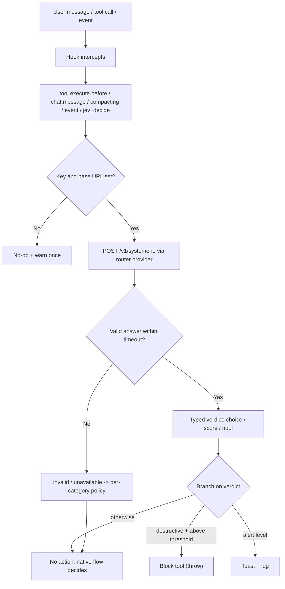
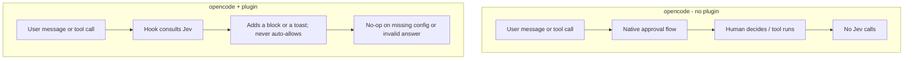

# @vheins/opencode-system-one

An [opencode](https://opencode.ai) plugin that routes **TypeSafe Jev (System One)** structured judgments through opencode's built-in plugin hooks.

Jev is not a drop-in model replacement. It answers named questions about a piece of state and returns **typed** results (`choice`, `score`, `noul`) that the plugin branches on to make guardrail decisions: block a destructive tool call, classify a message, triage a session error, and so on.

All Jev calls go through the configured router provider, which exposes a pass-through route at `POST /v1/systemone`. The router forwards the body untouched and returns the native System One JSON.

## How it works

The plugin sits between opencode events and the configured router provider. Each hook sends state plus a named question, receives a typed verdict, then branches. Every answer is validated before it is used; a missing key, missing base URL, timeout, transport error, or malformed verdict is reported as an explicit `invalid`/`unavailable` outcome rather than being treated as permission to proceed.

The plugin can only ever **add a block** to a tool call. It never auto-allows, so opencode's native approval flow remains the sole gate for execution.

### Runtime flow



Verdict types map to hooks in the [Hook / event map](#hook--event-map): `choice` drives risk, routing, and severity labels; `noul` drives compaction and file review probabilities; `score` is available through the `tool.jev_decide` custom tool.

### With and without the plugin



Without the plugin, every decision stays in the native approval flow. With the plugin, the same points consult Jev first and apply an additional guardrail, while a Jev outage or an unconfigured install returns control to the native flow.

## Install

### From npm (recommended)

Add the package to your opencode config (`opencode.json`):

```json
{
  "$schema": "https://opencode.ai/config.json",
  "plugin": ["@vheins/opencode-system-one"]
}
```

opencode installs the plugin with Bun at startup and caches it under `~/.cache/opencode/`. Then set the JEV key and base URL (see [Configuration](#configuration)) and restart opencode.

### From source

Clone this repository (or copy **both** the `.opencode/` directory **and** the root `src/` directory, preserving their relative layout). The local plugin entry `.opencode/plugins/jev.ts` is a thin re-export of `../../src/index`, so `src/` must sit beside `.opencode/`:

```
your-project/
  .opencode/
    plugins/jev.ts        # re-exports ../../src/index
    package.json
    .env.example
  src/
    index.ts              # canonical plugin source
```

opencode auto-discovers any `*.ts` file in `.opencode/plugins/`, so `jev.ts` loads automatically. Install the plugin's dependencies once:

```bash
cd .opencode && bun install   # or: npm install
```

Then restart opencode (config and plugins load at startup).

## Configuration

Copy `.opencode/.env.example` to `.env` (or export the variables in your shell). The JEV key and the base URL are both required; if either is unset the guardrails degrade to a no-op that warns once.

| Variable | Default | Purpose |
| --- | --- | --- |
| `JEV_API_KEY` | — | Bearer key for the router provider. If unset, the plugin falls back to `~/.config/opencode/.jev-key`, then no-ops with a warning. |
| `JEV_BASE_URL` | — (required) | Router pass-through route for System One judgments. **No default host is shipped**; an unset or blank value disables Jev (no-op + warn) rather than calling any host. |
| `JEV_MODEL` | `oc/jev-1.13-free` | Jev model id. |
| `JEV_BLOCK_THRESHOLD` | `0.85` | Block a destructive tool call when confidence exceeds this value. |
| `JEV_ROUTE_THRESHOLD` | `0.8` | Toast when `chat.message` classifies a message as `needs_human` at or above this confidence. |
| `JEV_SEVERITY_THRESHOLD` | `0.8` | Toast when a `session.error` severity resolves to `real_bug`/`fatal` at or above this confidence. |
| `JEV_COMPACT_THRESHOLD` | `0.75` | Append a preservation reminder to compaction context at or above this probability. |
| `JEV_FILE_REVIEW_THRESHOLD` | `0.8` | Toast when an edited file is judged security-sensitive at or above this probability. |

Thresholds are per category; there is no single global threshold across unrelated decisions. A value outside `[0, 1]` is ignored and the default is used, so a typo cannot widen a guardrail silently.

Key resolution order: `JEV_API_KEY` environment variable, then the file `~/.config/opencode/.jev-key`. **Never commit a real key.** The repository ignores `.env`, `*.key`, and similar files.

## Hook / event map

| Hook or event | Jev question | Behavior |
| --- | --- | --- |
| `tool.execute.before` | Choice: `read_only` \| `mutating` \| `destructive` | Blocks (throws) when the verdict is `destructive` and confidence > `JEV_BLOCK_THRESHOLD`. Known read-only tools skip the call. It never auto-allows; opencode's native flow still decides everything else. |
| `chat.message` | Choice: `code_only` \| `needs_model` \| `needs_human` | Classifies each user message, logs the verdict, and raises a TUI toast on a confident `needs_human`. This hook is **observe-only**: it cannot reroute the message, so the verdict is a classification, not routing. |
| `experimental.session.compacting` | Noul: "does this session hold unrecoverable decisions?" | Pushes a preservation reminder line into the summary context when the probability is high. Never replaces the compaction prompt. |
| `event` → `session.error` | Choice: `transient` \| `real_bug` \| `fatal` | Logs the severity; raises a toast on a confident non-transient verdict. A `MessageAbortedError` is ignored. |
| `event` → `file.edited` | Noul: "is this path security-sensitive / needs review?" | Logs a high verdict and raises a review toast. |
| `tool.jev_decide` (custom tool) | Choice / Score / Noul over arbitrary state | Exposes Jev directly to the agent; returns the typed answer as JSON. |

The plugin does **not** register a `permission.ask` handler. That hook is declared in the plugin types but is not triggered by opencode 1.19.0, so any handler would be dead code that appears to arbitrate permissions without doing so.

## Safety

The plugin is designed so it can never break opencode's flow and never weakens the native approval gate:

- **Missing key or base URL** — every hook degrades to a no-op and logs a warning once. opencode startup never crashes. No default host is ever called.
- **Invalid or unavailable verdict** — an absent, malformed, contradictory, out-of-range, timed-out, or disabled answer is reported as `invalid`/`unavailable` and carries no verdict. It is never treated as permission to proceed.
- **Per-category failure policy** — a non-actionable verdict for a high-impact action (destructive or high-impact category) surfaces a warning; low-risk categories stay silent. Neither case relaxes opencode's native approval flow.
- **Block only** — `tool.execute.before` either throws (deny) or returns (defer). The plugin cannot auto-allow, so a model verdict never bypasses opencode's permission controls.
- **Bounded network** — each request carries an `AbortSignal.timeout` and at most one retry, and only for transient failures (timeouts, connection errors, `429`, and `5xx`). A deterministic `4xx` is never retried.
- **No secret leakage** — the API key and request bodies are never written to logs.
- **Validated answers** — a `choice` verdict must carry a known label, a finite confidence in `[0, 1]`, and a probability map that does not contradict the selected label. A `noul` verdict must carry a probability in `[0, 1]`.

## Development

Typecheck and tests run against the source with no build step (Node 24 strips TypeScript):

```bash
./node_modules/.bin/tsc --noEmit          # strict typecheck
node --test "test/**/*.test.ts"           # unit + hook integration tests
```

## License

MIT. See [LICENSE](./LICENSE).
